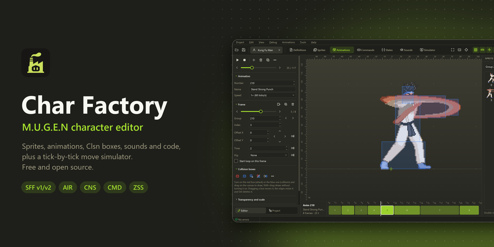
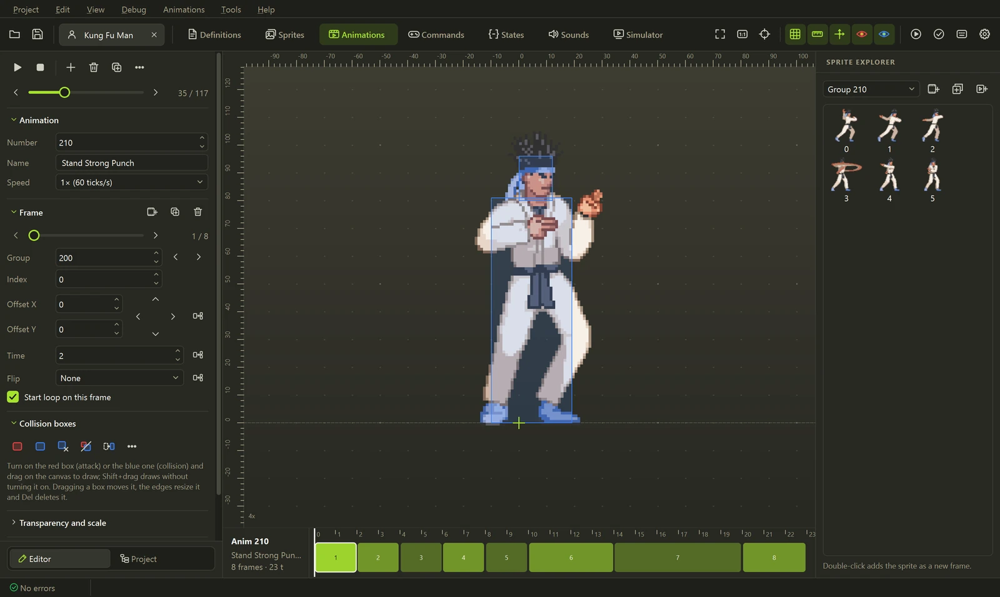
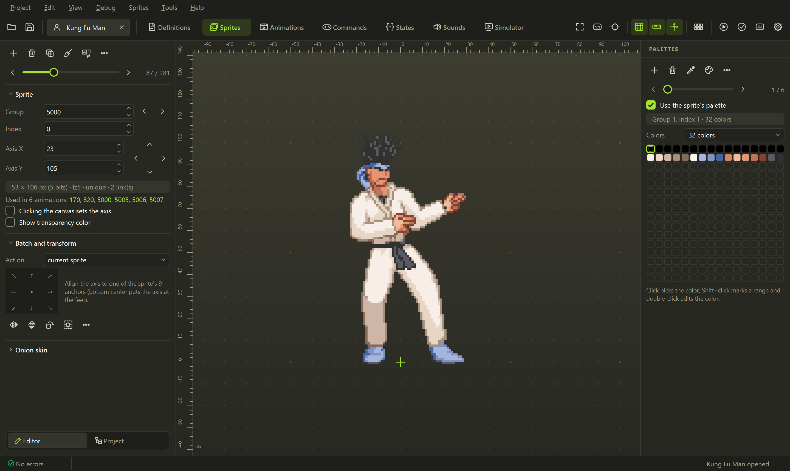
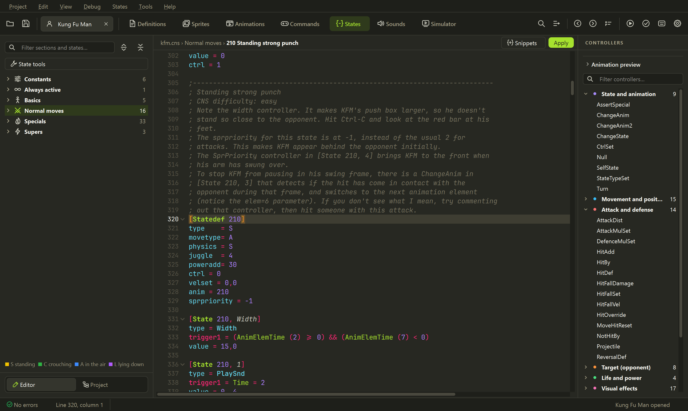
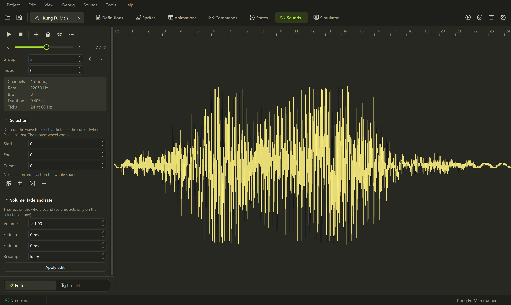
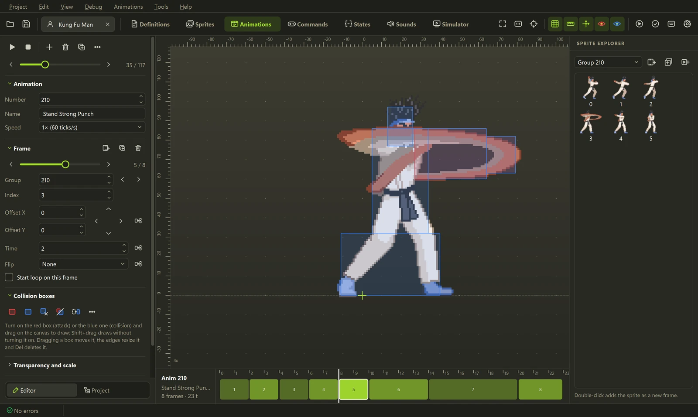

<p align="center">
  
</p>

<p align="center">
  <a href="../../releases/latest"></a>
  <a href="../../actions/workflows/ci.yml"></a>
  <a href="../../releases"></a>
  <a href="#agentes-de-ia-y-mcp"></a>
  <a href="LICENSE"></a>
</p>

<p align="center">
  Editor libre y de código abierto para personajes de <b>M.U.G.E.N</b> e <b>Ikemen GO</b>. Inspirado en <a href="https://virtualltek.com/">Fighter Factory</a>.<br>
  Sprites, animaciones, cajas de colisión, sonidos y código en una sola ventana, un simulador que ejecuta<br>
  tus golpes tick a tick y <b>agentes de IA</b> (Claude, Codex, Gemini) que editan el personaje contigo.
</p>

<p align="center">
  <b><a href="../../releases/latest">Descargar para Windows</a></b> ·
  <a href="#agentes-de-ia-y-mcp">IA y MCP</a> ·
  <a href="#lo-que-lo-hace-diferente">Lo que lo hace diferente</a> ·
  <a href="#los-editores">Los editores</a> ·
  <a href="#línea-de-comandos">Línea de comandos</a> ·
  <a href="#desarrollo">Desarrollo</a>
  <br>
  <sub><a href="README.md">English</a> · <b>Español</b> · <a href="README.fr.md">Français</a> · <a href="README.pt-BR.md">Português (Brasil)</a> · <a href="README.zh-CN.md">简体中文</a></sub>
</p>

## Primeros pasos

1. Descarga `Char-Factory-...-windows.zip` desde la **[última versión](../../releases/latest)**.
2. Descomprímelo donde quieras y abre **`Char Factory.exe`**. No hay nada que instalar.
3. Abre el `.def` de un personaje, o suelta un `.def`, `.zip`, `.rar` o `.7z` sobre la ventana.

La primera vez se elige el idioma y el tema. Si el personaje está dentro de tu carpeta de MUGEN o de
Ikemen GO, **Ejecutar en el motor** (<kbd>Ctrl</kbd>+<kbd>R</kbd>) encuentra ese motor por sí solo;
**Depurar → Ejecutar en MUGEN / Ejecutar en Ikemen GO** prueba el mismo personaje en el otro.

## Agentes de IA y MCP


<p align="center"><sub>Una petición, un golpe nuevo: el asistente elige las poses, crea las animaciones y los estados, conecta
el comando, corrige la patada que fallaba y muestra el resultado en el simulador. Herramientas reales sobre Kung Fu Man.</sub></p>

Pide un golpe con tus palabras y un agente de IA lo construye en el personaje abierto: lee los estados,
**mira las animaciones** para elegir las poses correctas, escribe el código, ajusta las cajas de colisión y
**ejecuta el golpe en el simulador** para confirmar que conecta antes de decirte que terminó. Cada cambio
aparece en el editor al instante, <kbd>Ctrl</kbd>+<kbd>Z</kbd> lo deshace y nada se escribe en el disco
hasta que guardes.

<table>
  <tr>
    <td width="50%" valign="top">
      <b>Asistente integrado</b> · <kbd>Ctrl</kbd>+<kbd>Mayús</kbd>+<kbd>A</kbd><br><br>
      Un panel lateral que habla con <b>Claude</b>, <b>OpenAI</b> (GPT) o <b>Gemini</b> con tu clave de API,
      o con un modelo local a través de Ollama o LM Studio. Sabe lo que estás viendo (el statedef
      bajo el cursor, la animación y el cuadro), así que <i>"hazlo más rápido"</i> funciona.
    </td>
    <td width="50%" valign="top">
      <b>Tu propio agente mediante MCP</b><br><br>
      <b>Claude Code</b>, <b>Codex</b>, <b>Claude Desktop</b>, <b>Gemini CLI</b>, <b>Cursor</b> o
      <b>VS Code</b> se conectan a Char Factory y editan el personaje en pantalla con <b>tu propia
      suscripción</b>, sin clave de API. Solo local (<code>127.0.0.1</code>) y protegido por un token.
    </td>
  </tr>
</table>


<details>
<summary><b>Lo que puede hacer el agente (35 herramientas)</b></summary>
<br>

| | Herramientas |
|---|---|
| **Entender un golpe** | `get_move` (statedef, animaciones, comando y veredicto en una llamada), `list_states`, `list_animations` con búsqueda, `test_command` (a qué estado lleva un comando) |
| **Ver** | `view_animations` (hoja de contactos con las poses candidatas), `view_animation`, `view_sprite` |
| **Crear** | `create_move` (statedef, comando y entrada en `[Statedef -1]`), `build_animation` (cajas ajustadas a cada sprite), `set_state`, `add_controller`, `add_command` |
| **Cambiar con precisión** | `edit_state` (un parámetro, se conservan los comentarios), `edit_animation` (cuadros, tiempos, cajas), `set_constant` |
| **Comprobar** | `simulate_state` (frame data y la trayectoria: adónde va el personaje, por qué lado golpea), `validate_character`, `mugen_reference`, `mugen_guide` |

Las protecciones vienen de serie: un golpe existente nunca se sobrescribe por accidente, un comando que
otro golpe ya usa se rechaza mostrando los libres, las cajas del AIR que el parser descartaría se rechazan,
y una respuesta cortada por el límite de salida nunca se aplica a medias.

</details>

### Cómo configurarlo

La forma más rápida: **IA → Conectar un agente (MCP)**, marca **Ejecutar el servidor MCP mientras Char
Factory esté abierto**, elige tu cliente y copia la configuración que aparece (la URL y tu token ya
vienen puestos). Deja Char Factory abierto con el personaje cargado mientras trabaja el agente.

<p align="center">
  
</p>

<details open>
<summary><b>Claude Code</b> (usa tu suscripción de Claude)</summary>
<br>

```powershell
claude mcp add --transport http charfactory http://127.0.0.1:47913/mcp --header "Authorization: Bearer <tu token>"
```

Luego inicia `claude` y pide, por ejemplo: *"Abre el personaje en Char Factory, mira las patadas
agachado y haz una nueva que golpee abajo"*. `/mcp` muestra que `charfactory` está conectado.

Sin la ventana, Claude Code también puede ejecutar el servidor por su cuenta sobre un personaje:
`claude mcp add charfactory -- "C:\ruta\a\Char Factory.exe" --mcp "C:\ruta\a\char.def"`.

</details>

<details>
<summary><b>Codex</b> (usa tu suscripción de ChatGPT)</summary>
<br>

Agrega a `~/.codex/config.toml`:

```toml
[mcp_servers.charfactory]
url = "http://127.0.0.1:47913/mcp"
http_headers = { "Authorization" = "Bearer <tu token>" }
```

Luego ejecuta `codex` y pide el cambio. O inicia el servidor por stdio:
`codex mcp add charfactory -- "C:\ruta\a\Char Factory.exe" --mcp`.

</details>

<details>
<summary><b>Claude Desktop, Gemini CLI, Cursor, VS Code</b></summary>
<br>

La lista **Conectar un cliente**, en la misma pestaña, tiene el fragmento exacto para cada uno. Claude Desktop
inicia `Char Factory.exe --mcp`, que se conecta a la ventana abierta (agrégalo a
`claude_desktop_config.json` en *Settings → Developer → Edit Config* y reinicia Claude). Cualquier otro
cliente habla Streamable HTTP con `http://127.0.0.1:47913/mcp` usando la cabecera
`Authorization: Bearer <tu token>`.

</details>

<details>
<summary><b>Asistente integrado con clave de API</b> (Claude, OpenAI o Gemini)</summary>
<br>

1. **IA → Configuración de IA…**, pestaña **Asistente**.
2. Elige el proveedor: **Anthropic (Claude)**, **OpenAI (GPT)**, **Google Gemini**, u
   **OpenAI-compatible** para OpenRouter, Ollama o LM Studio (indica su URL base).
3. Pega la clave (**Obtener una clave** abre la página del proveedor) y pulsa **Probar conexión**, que
   también carga los modelos en la lista. Claude usa `claude-opus-5-5` por defecto.
4. Abre el panel con <kbd>Ctrl</kbd>+<kbd>Mayús</kbd>+<kbd>A</kbd> y pide.

La clave se guarda en el Administrador de credenciales de Windows, nunca en el archivo de configuración.
Sin una clave guardada se usa `ANTHROPIC_API_KEY`, `OPENAI_API_KEY` o `GEMINI_API_KEY`. Con Claude, el
asistente guarda el prompt en caché y piensa de forma adaptativa, así que las sesiones largas siguen siendo
rápidas y baratas.

</details>

> [!TIP]
> Marca **Preguntar antes de que una IA cambie el personaje** para aprobar cada cambio, y usa las líneas
> de pasos del panel (haz clic en una) para ver exactamente qué envió y qué recibió el agente.

## Lo que lo hace diferente

### Frame data, y un backup al lado


<kbd>F9</kbd> ejecuta un estado tick a tick, con helpers, explods y pausas de impacto, y mide los cuadros
de startup, activos y de recuperación y la ventaja al golpear o al ser bloqueado. Elige un backup en
**Comparar** y las dos versiones se ven lado a lado. El P2 puede estar de pie, cubrirse, agacharse o estar
en el aire, y los golpes se encadenan en combos.

### Una línea de tiempo que edita el código


Cada cuadro, impacto, sonido y efecto de un golpe en una sola pista. Arrastra un sonido o un efecto a otro
tick y su trigger se reescribe (`Time = N`, `!Time` o `AnimElem = N`); haz doble clic en cualquier evento
para abrir su controller.

### Cajas de colisión en un clic


Clsn2 anatómicos (cabeza, torso, piernas) a partir de la silueta del sprite, el Clsn1 de ataque en la
extremidad extendida, y cajas interpoladas entre dos cuadros clave.

### Paleta de comandos e ir a la definición


<kbd>F1</kbd> ejecuta cualquier comando o salta a `anim 200`, `state 1000`, `sprite 9000,0` o `sound 5,0`.
En el código, <kbd>F12</kbd> o <kbd>Ctrl</kbd>+clic abre la definición bajo el cursor.

### Y las herramientas de alrededor

<table>
  <tr>
    <td width="50%" valign="top">
      <br>
      <b>Trasplante de golpes</b><br>
      Copia un golpe entero de otro personaje siguiendo <code>ChangeState</code>,
      <code>Helper</code> y <code>p1/p2stateno</code>, con sus animaciones, sprites, sonidos y
      comando, renumerados para que nada choque.
    </td>
    <td width="50%" valign="top">
      <br>
      <b>Asistente de golpes</b><br>
      Diseña un golpe de forma visual (HitDef, física, sonidos, cancels, comando) y mira cómo se
      escribe el CNS mientras editas.
    </td>
  </tr>
  <tr>
    <td width="50%" valign="top">
      <br>
      <b>Recortador de sprite sheets</b><br>
      Encuentra el fondo y cada cuadro, pone el eje en los pies y arma una sola paleta, listo
      para importar.
    </td>
    <td width="50%" valign="top">
      <br>
      <b>Un editor de paletas, 12 paletas por bandas de color</b><br>
      Todas las paletas en una tira, herramientas de color, la paleta nueva vista antes de guardar, y una
      pestaña que bloquea lo que no debe cambiar (piel, contorno) y genera las paletas 2 a 12. Con Ctrl+Z.
    </td>
  </tr>
  <tr>
    <td width="50%" valign="top">
      <br>
      <b>Editor de píxeles sobre los índices de la paleta</b><br>
      <kbd>Ctrl</kbd>+<kbd>E</kbd>: selección, varita mágica, contorno, papel cebolla, y
      <kbd>RePág</kbd>/<kbd>AvPág</kbd> por los sprites sin cerrarlo.
    </td>
    <td width="50%" valign="top">
      <br>
      <b>Recursos sin usar</b><br>
      Sprites, animaciones y sonidos que nada referencia, listos para borrar antes de publicar.
    </td>
  </tr>
</table>

## Los editores



Animaciones en un lienzo con reglas, cuadrícula y eje, cajas Clsn dibujadas con el ratón, cada cuadro en
una línea de tiempo del tamaño de su duración, escala, ángulo e interpolación de MUGEN 1.1, y exportación a GIF.

<table>
  <tr>
    <td width="50%" valign="top">
      <br>
      <b>Sprites y paletas</b><br>
      Importa, exporta y alinea sprites, edita paletas y archivos ACT, o abre un sprite en un
      editor externo como Aseprite.
    </td>
    <td width="50%" valign="top">
      <br>
      <b>Código</b><br>
      CNS, CMD, AIR y DEF con resaltado, documentación al pasar el ratón, snippets y validación en vivo; los
      comentarios se conservan al guardar.
    </td>
  </tr>
  <tr>
    <td width="50%" valign="top">
      <br>
      <b>Sonidos</b><br>
      Reproduce, recorta, aplica fundidos y remuestrea sobre una regla medida en ticks de juego; importa WAV, OGG, MP3 y FLAC.
    </td>
    <td width="50%" valign="top">
      <br>
      <b>Temas</b><br>
      Ocho temas incluidos, un editor de temas e importación de colorsets <code>.xml</code>.
    </td>
  </tr>
</table>

<details>
<summary><b>Todo lo demás</b></summary>
<br>

- **Herramientas:** probador de comandos, creador de agarres, editor de PalFX, visor de offsets,
  organizador de `[Statedef -1]`, lista de uso de variables, calculadora y exportación de la lista de golpes en HTML.
- **Escenarios:** capas, propiedades y una vista previa con cámara y parallax.
- **Proyectos:** varios personajes en pestañas, deshacer y rehacer en todo, backup automático, comparar con un
  backup, buscar y reemplazar en todos los archivos, abrir y empaquetar `.zip`.
- **Idiomas:** inglés, español, francés, portugués (Brasil) y chino simplificado, con tamaño de texto
  ajustable para la interfaz y el código.

</details>

### Formatos compatibles

| Formato | Lee | Escribe |
|---|:---:|:---:|
| SFF v1.01 (PCX) y v2.00/2.01 (RLE8, RLE5, LZ5, PNG) | ✓ | ✓ <sub>(salvo RLE5)</sub> |
| AIR, CMD, CNS, ST, DEF <sub>(se conservan los comentarios)</sub> | ✓ | ✓ |
| ZSS (Ikemen GO) | ✓ | ✓ |
| SND, ACT | ✓ | ✓ |
| ZIP, RAR, 7z (personaje comprimido) | ✓ | ZIP |

## Línea de comandos


Todo lo que el editor hace con los archivos también funciona desde scripts o CI, sin ventana:

```powershell
charfactory render kfm.def 200 out.gif    # renderiza una animación
charfactory sim kfm.def 210 --gif         # simula un estado tick a tick
charfactory convert-sff in.sff out.sff --version 1
charfactory run kfm.def --engine ikemen    # un combate rápido en Ikemen GO (o mugen, o auto)
charfactory mcp kfm.def                   # servidor MCP por stdio, para agentes (sin ventana)
charfactory --help                        # todos los comandos
```

## Desarrollo

Necesita Python 3.11 o posterior.

```powershell
git clone https://github.com/eduardovbe/CharFactory.git
cd CharFactory
python -m venv .venv
.venv\Scripts\pip install -e ".[gui,test]"
.venv\Scripts\charfactory-gui
```

Las pruebas, las traducciones, la compilación del ejecutable y la regeneración de estas capturas se
explican en [CONTRIBUTING.md](CONTRIBUTING.md) (en inglés). Los reportes de errores, traducciones y pull
requests son bienvenidos; sigue el [Código de conducta](CODE_OF_CONDUCT.md) e informa los problemas de
seguridad como se indica en [SECURITY.md](SECURITY.md).

## Licencia

[MIT](LICENSE). La fuente JetBrains Mono incluida está bajo la SIL Open Font License 1.1.

<sub>Inspirado en Fighter Factory. Proyecto independiente, sin relación con Elecbyte, los autores de Fighter
Factory, Anthropic, OpenAI ni Google. M.U.G.E.N es una marca de Elecbyte. Las capturas muestran a Kung Fu
Man, el personaje de ejemplo que viene con M.U.G.E.N.</sub>
