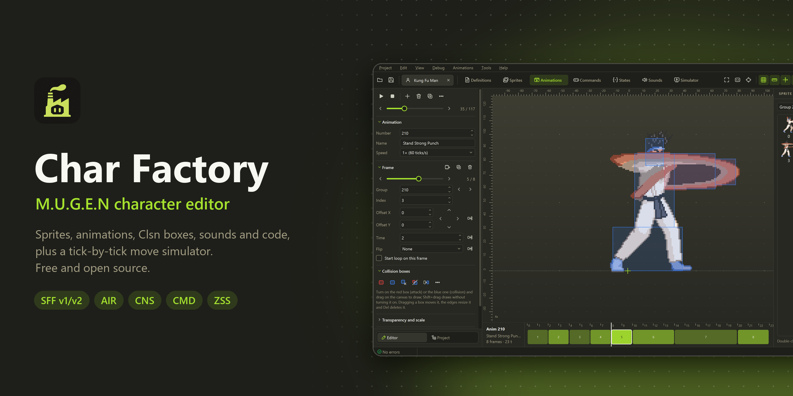
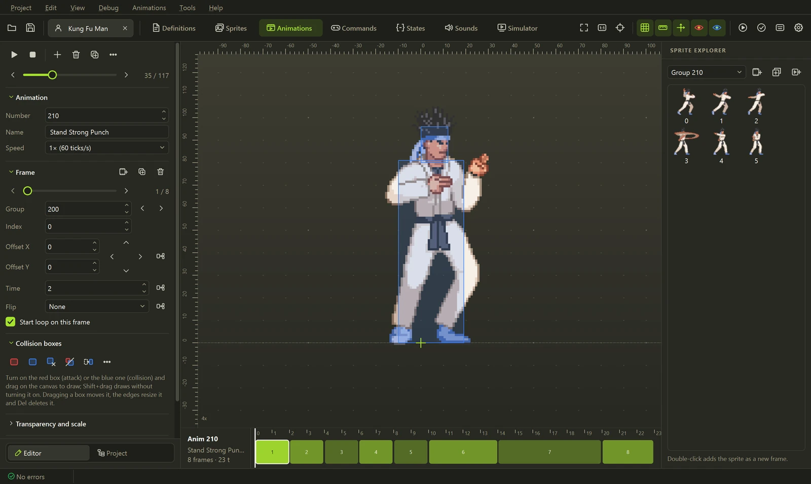
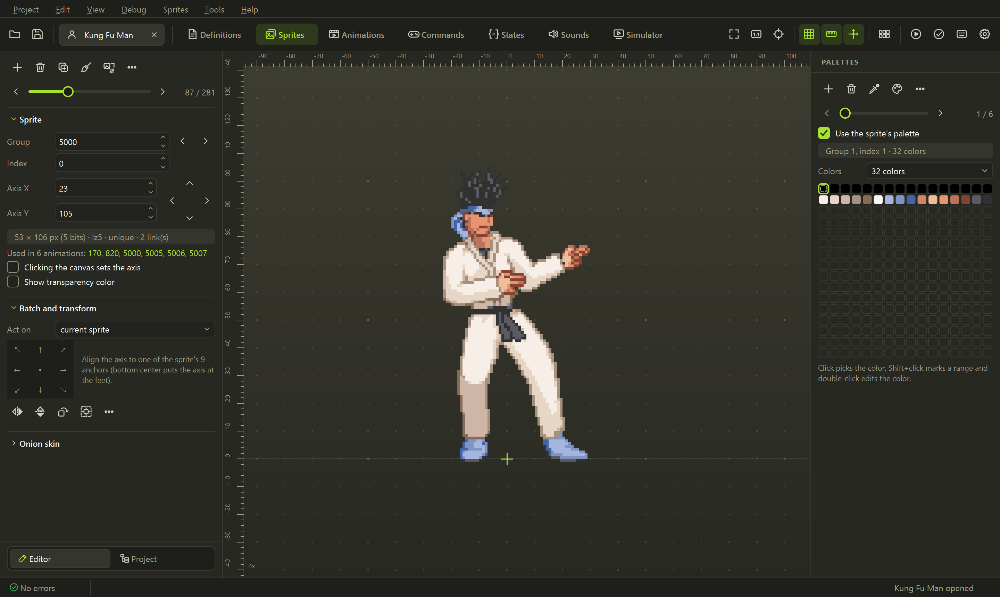
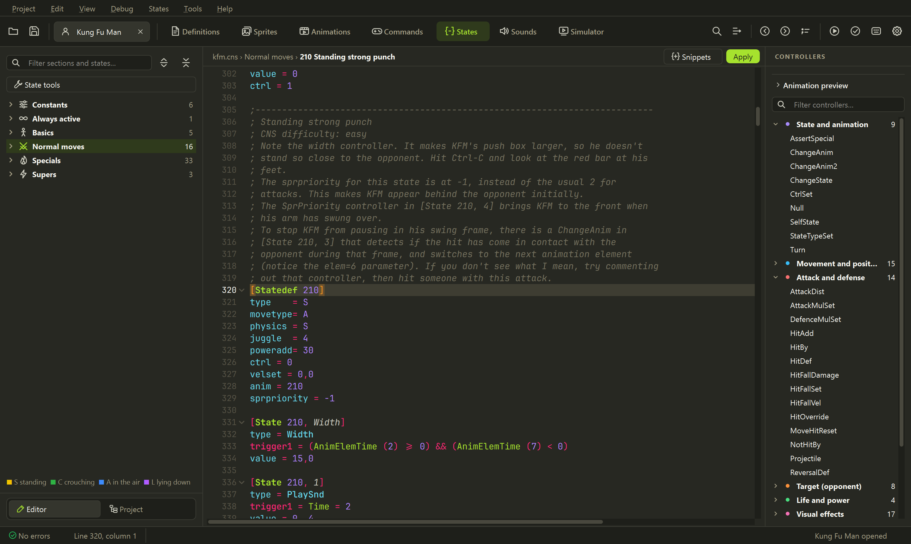
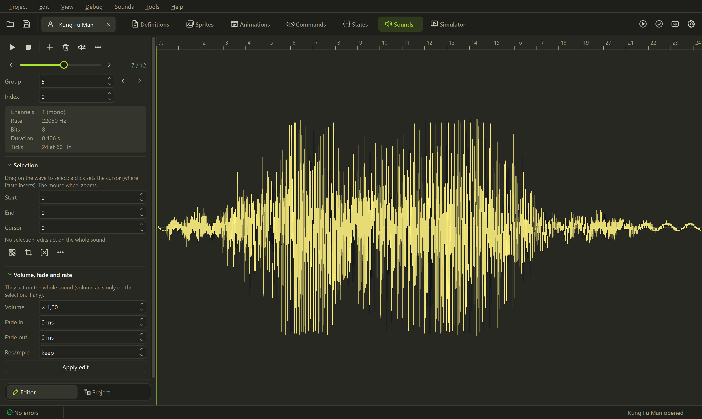
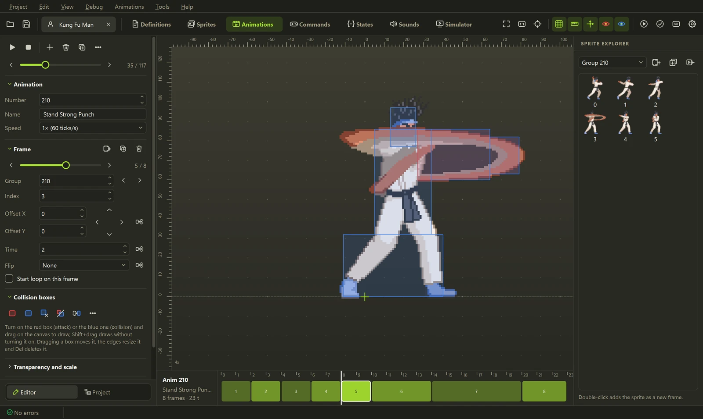

<p align="center">
  
</p>

<p align="center">
  <a href="../../releases/latest"></a>
  <a href="../../actions/workflows/ci.yml"></a>
  <a href="../../releases"></a>
  <a href="#agents-ia-et-mcp"></a>
  <a href="LICENSE"></a>
</p>

<p align="center">
  Un éditeur libre et open source pour les personnages <b>M.U.G.E.N</b> et <b>Ikemen GO</b>. Inspiré de <a href="https://virtualltek.com/">Fighter Factory</a>.<br>
  Sprites, animations, boîtes de collision, sons et code dans une seule fenêtre, un simulateur qui joue<br>
  vos coups tick par tick, et des <b>agents IA</b> (Claude, Codex, Gemini) qui modifient le personnage avec vous.
</p>

<p align="center">
  <b><a href="../../releases/latest">Télécharger pour Windows</a></b> ·
  <a href="#agents-ia-et-mcp">IA et MCP</a> ·
  <a href="#ce-qui-le-rend-différent">Ce qui le rend différent</a> ·
  <a href="#les-éditeurs">Les éditeurs</a> ·
  <a href="#ligne-de-commande">Ligne de commande</a> ·
  <a href="#développement">Développement</a>
  <br>
  <a href="README.md"> English</a> &nbsp;·&nbsp; <a href="README.es.md"> Español</a> &nbsp;·&nbsp;  <b>Français</b> &nbsp;·&nbsp; <a href="README.pt-BR.md"> Português (Brasil)</a> &nbsp;·&nbsp; <a href="README.zh-CN.md"> 简体中文</a>
</p>

## Démarrer

1. Téléchargez `Char-Factory-...-windows.zip` depuis la **[dernière version](../../releases/latest)**.
2. Décompressez-le où vous voulez et ouvrez **`Char Factory.exe`**. Rien à installer.
3. Ouvrez le `.def` d'un personnage, ou déposez un `.def`, `.zip`, `.rar` ou `.7z` sur la fenêtre.

Au premier lancement, l'application demande la langue et le thème. Si le personnage se trouve dans votre
dossier MUGEN ou Ikemen GO, **Lancer dans le moteur** (<kbd>Ctrl</kbd>+<kbd>R</kbd>) trouve ce moteur tout
seul ; **Débogage → Lancer dans MUGEN / Lancer dans Ikemen GO** teste le même personnage dans l'autre.

## Agents IA et MCP


<p align="center"><sub>Une demande, un nouveau coup : l'assistant choisit les poses, crée les animations et les états, branche
la commande, corrige le coup de pied qui ratait et montre le résultat dans le simulateur. De vrais outils, sur Kung Fu Man.</sub></p>

Demandez un coup avec vos propres mots et un agent IA le construit dans le personnage ouvert : il lit les
états, **regarde les animations** pour choisir les bonnes poses, écrit le code, ajuste les boîtes de collision
et **joue le coup dans le simulateur** pour vérifier qu'il touche avant de vous dire qu'il a fini. Chaque
modification apparaît tout de suite dans l'éditeur, <kbd>Ctrl</kbd>+<kbd>Z</kbd> l'annule, et rien n'est
écrit sur le disque avant que vous n'enregistriez.

<table>
  <tr>
    <td width="50%" valign="top">
      <b>Assistant intégré</b> · <kbd>Ctrl</kbd>+<kbd>Maj</kbd>+<kbd>A</kbd><br><br>
      Un panneau latéral qui parle à <b>Claude</b>, <b>OpenAI</b> (GPT) ou <b>Gemini</b> avec votre clé d'API,
      ou à un modèle local via Ollama ou LM Studio. Il sait ce que vous regardez (le statedef sous le
      curseur, l'animation et l'image), donc <i>« rends ça plus rapide »</i> fonctionne.
    </td>
    <td width="50%" valign="top">
      <b>Votre propre agent via MCP</b><br><br>
      <b>Claude Code</b>, <b>Codex</b>, <b>Claude Desktop</b>, <b>Gemini CLI</b>, <b>Cursor</b> ou
      <b>VS Code</b> se connectent à Char Factory et modifient le personnage à l'écran avec <b>votre propre
      abonnement</b>, sans clé d'API. En local uniquement (<code>127.0.0.1</code>) et protégé par un jeton.
    </td>
  </tr>
</table>


<details>
<summary><b>Ce que l'agent sait faire (35 outils)</b></summary>
<br>

| | Outils |
|---|---|
| **Comprendre un coup** | `get_move` (statedef, animations, commande et verdict en un appel), `list_states`, `list_animations` avec recherche, `test_command` (l'état atteint par une commande) |
| **Voir** | `view_animations` (planche contact des poses candidates), `view_animation`, `view_sprite` |
| **Créer** | `create_move` (statedef, commande et entrée dans `[Statedef -1]`), `build_animation` (boîtes ajustées à chaque sprite), `set_state`, `add_controller`, `add_command` |
| **Modifier avec précision** | `edit_state` (un paramètre, commentaires conservés), `edit_animation` (images, timing, boîtes), `set_constant` |
| **Vérifier** | `simulate_state` (frame data et trajectoire : où va le personnage, de quel côté il touche), `validate_character`, `mugen_reference`, `mugen_guide` |

Les garde-fous sont intégrés : un coup existant n'est jamais écrasé par accident, une commande déjà
utilisée par un autre coup est refusée avec la liste des commandes libres, les boîtes AIR que le parseur
ignorerait sont rejetées, et une réponse coupée par la limite de sortie n'est jamais appliquée à moitié.

</details>

### Mise en place

Le plus rapide : **IA → Connecter un agent (MCP)**, cochez **Faire tourner le serveur MCP tant que Char
Factory est ouvert**, choisissez votre client et copiez la configuration affichée (l'URL et votre jeton
sont déjà remplis). Laissez Char Factory ouvert avec le personnage chargé pendant que l'agent travaille.

<p align="center">
  
</p>

<details open>
<summary><b>Claude Code</b> (utilise votre abonnement Claude)</summary>
<br>

```powershell
claude mcp add --transport http charfactory http://127.0.0.1:47913/mcp --header "Authorization: Bearer <votre jeton>"
```

Lancez ensuite `claude` et demandez par exemple : *« Ouvre le personnage dans Char Factory, regarde les
coups de pied accroupis et fais-en un nouveau qui frappe bas »*. `/mcp` indique que `charfactory` est connecté.

Sans la fenêtre, Claude Code peut aussi lancer le serveur lui-même sur un personnage :
`claude mcp add charfactory -- "C:\chemin\vers\Char Factory.exe" --mcp "C:\chemin\vers\char.def"`.

</details>

<details>
<summary><b>Codex</b> (utilise votre abonnement ChatGPT)</summary>
<br>

Ajoutez à `~/.codex/config.toml` :

```toml
[mcp_servers.charfactory]
url = "http://127.0.0.1:47913/mcp"
http_headers = { "Authorization" = "Bearer <votre jeton>" }
```

Lancez ensuite `codex` et demandez la modification. Ou démarrez le serveur en stdio :
`codex mcp add charfactory -- "C:\chemin\vers\Char Factory.exe" --mcp`.

</details>

<details>
<summary><b>Claude Desktop, Gemini CLI, Cursor, VS Code</b></summary>
<br>

La liste **Connecter un client**, dans le même onglet, donne l'extrait exact pour chacun. Claude Desktop
lance `Char Factory.exe --mcp`, qui se connecte à la fenêtre ouverte (ajoutez-le à
`claude_desktop_config.json` via *Settings → Developer → Edit Config* et redémarrez Claude). Tout autre
client parle Streamable HTTP avec `http://127.0.0.1:47913/mcp` en envoyant l'en-tête
`Authorization: Bearer <votre jeton>`.

</details>

<details>
<summary><b>Assistant intégré avec une clé d'API</b> (Claude, OpenAI ou Gemini)</summary>
<br>

1. **IA → Réglages de l'IA…**, onglet **Assistant**.
2. Choisissez le fournisseur : **Anthropic (Claude)**, **OpenAI (GPT)**, **Google Gemini**, ou
   **OpenAI-compatible** pour OpenRouter, Ollama ou LM Studio (indiquez son URL de base).
3. Collez la clé (**Obtenir une clé** ouvre la page du fournisseur) et cliquez sur **Tester la connexion**,
   qui charge aussi les modèles dans la liste. Claude utilise `claude-opus-5-5` par défaut.
4. Ouvrez le panneau avec <kbd>Ctrl</kbd>+<kbd>Maj</kbd>+<kbd>A</kbd> et demandez.

La clé est stockée dans le Gestionnaire d'identification de Windows, jamais dans le fichier de réglages.
Sans clé enregistrée, `ANTHROPIC_API_KEY`, `OPENAI_API_KEY` ou `GEMINI_API_KEY` est utilisée. Avec Claude,
l'assistant met le prompt en cache et réfléchit de façon adaptative : les longues sessions d'édition restent
rapides et peu coûteuses.

</details>

> [!TIP]
> Cochez **Demander avant qu'une IA modifie le personnage** pour approuver chaque modification, et utilisez
> les lignes d'étape du panneau (cliquez sur l'une d'elles) pour voir exactement ce que l'agent a envoyé et reçu.

## Ce qui le rend différent

### Frame data, et une sauvegarde côte à côte


<kbd>F9</kbd> joue un état tick par tick, avec helpers, explods et pauses à l'impact, et mesure les images
de startup, actives et de récupération ainsi que l'avantage à l'impact ou en garde. Choisissez une sauvegarde
dans **Comparer** et les deux versions se jouent côte à côte. Le P2 peut être debout, en garde, accroupi ou
en l'air, et les coups s'enchaînent en combos.

### Une timeline qui modifie le code


Chaque image, touche, son et effet d'un coup sur une seule piste. Glissez un son ou un effet vers un autre
tick et son trigger est réécrit (`Time = N`, `!Time` ou `AnimElem = N`) ; double-cliquez sur n'importe quel
événement pour ouvrir son controller.

### Des boîtes de collision en un clic


Des Clsn2 anatomiques (tête, torse, jambes) tirés de la silhouette du sprite, le Clsn1 d'attaque sur le
membre tendu, et des boîtes interpolées entre deux images clés.

### Palette de commandes et aller à la définition


<kbd>F1</kbd> lance n'importe quelle commande ou saute vers `anim 200`, `state 1000`, `sprite 9000,0` ou
`sound 5,0`. Dans le code, <kbd>F12</kbd> ou <kbd>Ctrl</kbd>+clic ouvre la définition sous le curseur.

### Et les outils autour

<table>
  <tr>
    <td width="50%" valign="top">
      <br>
      <b>Transplantation de coups</b><br>
      Copie un coup entier d'un autre personnage en suivant <code>ChangeState</code>,
      <code>Helper</code> et <code>p1/p2stateno</code>, avec ses animations, sprites, sons et
      commande, renumérotés pour éviter toute collision.
    </td>
    <td width="50%" valign="top">
      <br>
      <b>Assistant de coups</b><br>
      Concevez un coup visuellement (HitDef, physique, sons, cancels, commande) et regardez le CNS
      s'écrire pendant que vous modifiez.
    </td>
  </tr>
  <tr>
    <td width="50%" valign="top">
      <br>
      <b>Découpe de planches de sprites</b><br>
      Trouve le fond et chaque image, place l'axe aux pieds et construit une seule palette, prêt
      à importer.
    </td>
    <td width="50%" valign="top">
      <br>
      <b>Un éditeur de palettes, 12 palettes par bandes de couleur</b><br>
      Toutes les palettes sur une bande, des outils de couleur, la nouvelle palette prévisualisée avant
      d'enregistrer, et un onglet qui verrouille ce qui ne doit pas changer (peau, contour) et génère les
      palettes 2 à 12. Avec Ctrl+Z.
    </td>
  </tr>
  <tr>
    <td width="50%" valign="top">
      <br>
      <b>Éditeur de pixels sur les indices de palette</b><br>
      <kbd>Ctrl</kbd>+<kbd>E</kbd> : sélection, baguette magique, contour, pelure d'oignon, et
      <kbd>PgUp</kbd>/<kbd>PgDn</kbd> d'un sprite à l'autre sans le fermer.
    </td>
    <td width="50%" valign="top">
      <br>
      <b>Ressources inutilisées</b><br>
      Les sprites, animations et sons que rien ne référence, prêts à supprimer avant la publication.
    </td>
  </tr>
</table>

## Les éditeurs



Les animations sur un canevas avec règles, grille et axe, des boîtes Clsn dessinées à la souris, chaque image
sur une timeline proportionnelle à sa durée, l'échelle, l'angle et l'interpolation de MUGEN 1.1, et l'export en GIF.

<table>
  <tr>
    <td width="50%" valign="top">
      <br>
      <b>Sprites et palettes</b><br>
      Importez, exportez et alignez des sprites, modifiez les palettes et les fichiers ACT, ou ouvrez un
      sprite dans un éditeur externe comme Aseprite.
    </td>
    <td width="50%" valign="top">
      <br>
      <b>Code</b><br>
      CNS, CMD, AIR et DEF avec coloration, documentation au survol, snippets et validation en direct ; les
      commentaires sont conservés à l'enregistrement.
    </td>
  </tr>
  <tr>
    <td width="50%" valign="top">
      <br>
      <b>Sons</b><br>
      Lecture, coupe, fondus et rééchantillonnage sur une règle graduée en ticks de jeu ; importe WAV, OGG, MP3 et FLAC.
    </td>
    <td width="50%" valign="top">
      <br>
      <b>Thèmes</b><br>
      Huit thèmes intégrés, un éditeur de thèmes et l'import de colorsets <code>.xml</code>.
    </td>
  </tr>
</table>

<details>
<summary><b>Tout le reste</b></summary>
<br>

- **Outils :** testeur de commandes, créateur de projections, éditeur de PalFX, visionneuse d'offsets,
  organisateur de `[Statedef -1]`, liste d'utilisation des variables, calculatrice et export de la liste des coups en HTML.
- **Stages :** calques, propriétés et un aperçu avec caméra et parallaxe.
- **Projets :** plusieurs personnages en onglets, annuler et rétablir partout, sauvegarde automatique, comparaison
  avec une sauvegarde, rechercher et remplacer dans tous les fichiers, ouverture et création de `.zip`.
- **Langues :** anglais, espagnol, français, portugais (Brésil) et chinois simplifié, avec une taille de
  texte réglable pour l'interface et le code.

</details>

### Formats pris en charge

| Format | Lecture | Écriture |
|---|:---:|:---:|
| SFF v1.01 (PCX) et v2.00/2.01 (RLE8, RLE5, LZ5, PNG) | ✓ | ✓ <sub>(sauf RLE5)</sub> |
| AIR, CMD, CNS, ST, DEF <sub>(commentaires conservés)</sub> | ✓ | ✓ |
| ZSS (Ikemen GO) | ✓ | ✓ |
| SND, ACT | ✓ | ✓ |
| ZIP, RAR, 7z (personnage archivé) | ✓ | ZIP |

## Ligne de commande


Tout ce que l'éditeur fait aux fichiers fonctionne aussi depuis des scripts ou la CI, sans fenêtre :

```powershell
charfactory render kfm.def 200 out.gif    # rend une animation
charfactory sim kfm.def 210 --gif         # simule un état tick par tick
charfactory convert-sff in.sff out.sff --version 1
charfactory run kfm.def --engine ikemen    # un combat rapide dans Ikemen GO (ou mugen, ou auto)
charfactory mcp kfm.def                   # serveur MCP en stdio, pour les agents (sans fenêtre)
charfactory --help                        # toutes les commandes
```

## Développement

Nécessite Python 3.11 ou plus récent.

```powershell
git clone https://github.com/eduardovbe/CharFactory.git
cd CharFactory
python -m venv .venv
.venv\Scripts\pip install -e ".[gui,test]"
.venv\Scripts\charfactory-gui
```

Les tests, les traductions, la création de l'exécutable et la régénération de ces captures sont décrits dans
[CONTRIBUTING.md](CONTRIBUTING.md) (en anglais). Les rapports de bugs, traductions et pull requests sont les
bienvenus ; merci de suivre le [Code de conduite](CODE_OF_CONDUCT.md) et de signaler les problèmes de
sécurité comme indiqué dans [SECURITY.md](SECURITY.md).

## Licence

[MIT](LICENSE). La police JetBrains Mono incluse est sous licence SIL Open Font License 1.1.

<sub>Inspiré de Fighter Factory. Projet indépendant, sans lien avec Elecbyte, les auteurs de Fighter Factory,
Anthropic, OpenAI ou Google. M.U.G.E.N est une marque d'Elecbyte. Les captures montrent Kung Fu Man, le
personnage d'exemple fourni avec M.U.G.E.N.</sub>
