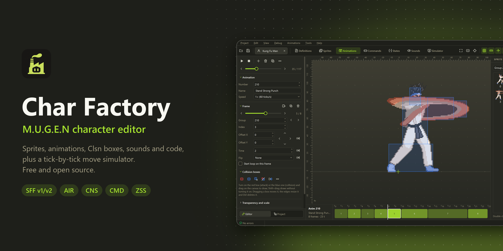
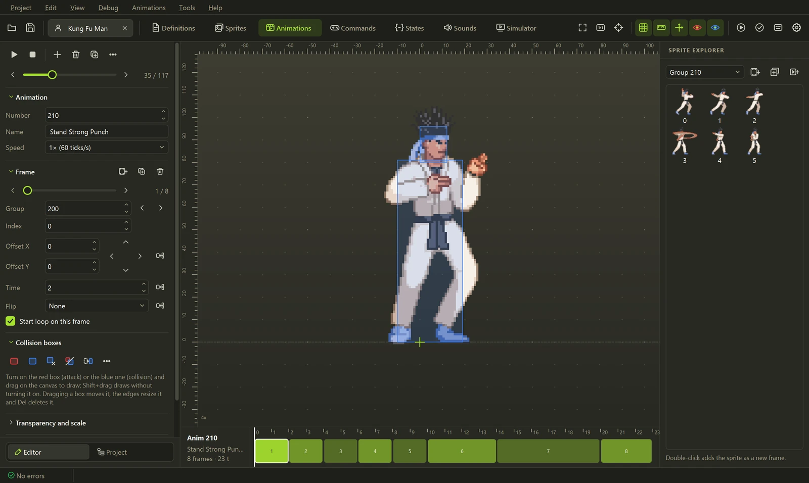
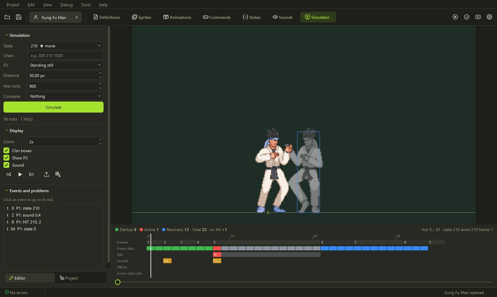
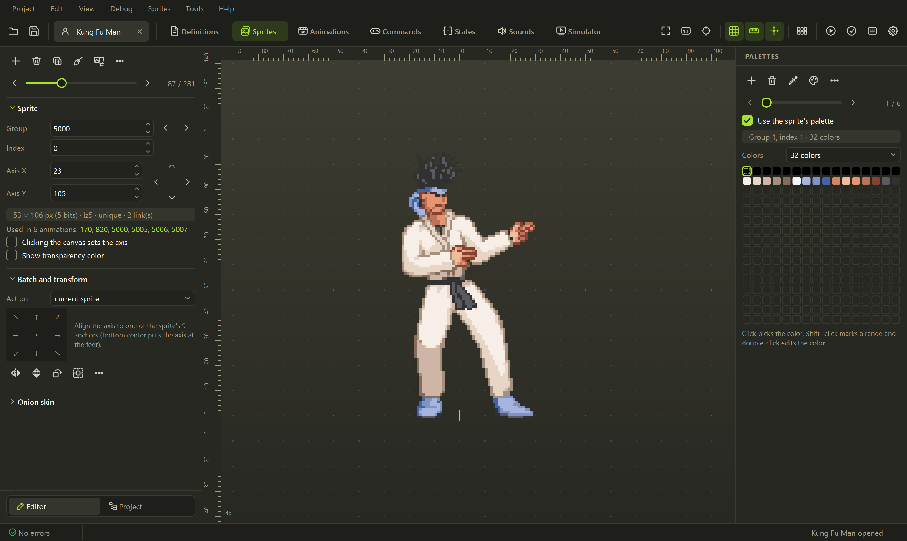
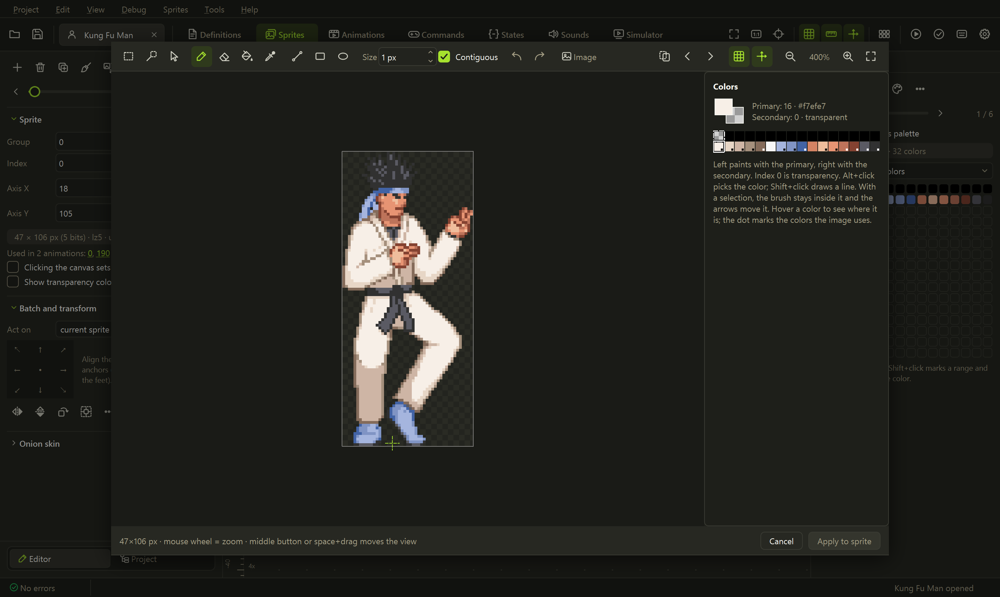
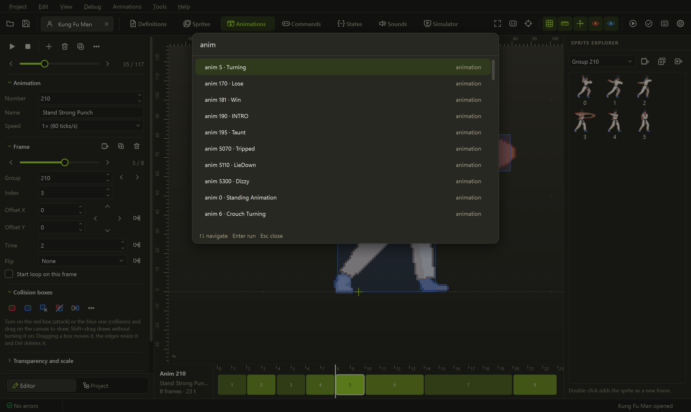
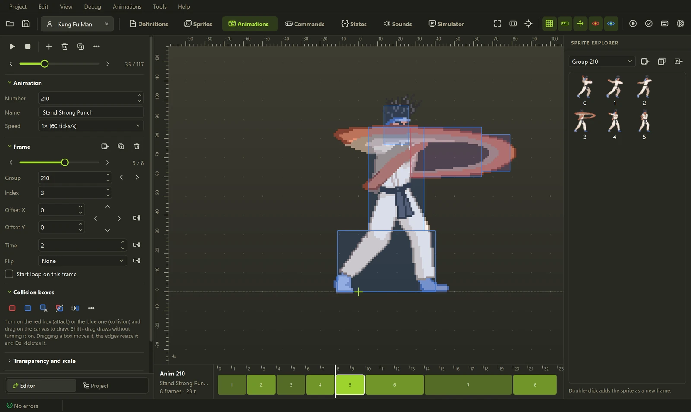

<p align="center">
  
</p>

<p align="center">
  <a href="../../releases/latest"></a>
  <a href="../../actions/workflows/ci.yml"></a>
  <a href="../../releases"></a>
  <a href="LICENSE"></a>
  
</p>

<p align="center">
  <b><a href="../../releases/latest">Download</a></b> ·
  <a href="#highlights">Highlights</a> ·
  <a href="#all-features">All features</a> ·
  <a href="#command-line">Command line</a> ·
  <a href="CONTRIBUTING.md">Contributing</a>
</p>

<p align="center">
  A free, open source editor for <b>M.U.G.E.N</b> and <b>Ikemen GO</b> characters.<br>
  Sprites, animations with collision boxes, sounds, commands and states in one window,<br>
  plus a simulator that plays your moves tick by tick without opening the engine.
</p>

<p align="center">
  <sub>English · Español · Português (Brasil)</sub>
</p>

---

## Get started in 30 seconds

1. Download `Char-Factory-...-windows.zip` from the **[latest release](../../releases/latest)**.
2. Extract it anywhere and open **`Char Factory.exe`**. Nothing to install.
3. Open a character's `.def`, or drop a `.def`, `.zip`, `.rar` or `.7z` on the window.

The first launch asks for the language and the theme; both can be changed later in **View**.
If the character lives inside your MUGEN folder, **Run in the engine** (<kbd>Ctrl</kbd>+<kbd>R</kbd>)
finds MUGEN by itself.

## Highlights

### Animations and collision boxes



Draw and resize Clsn1/Clsn2 boxes with the mouse, nudge offsets pixel by pixel and see every frame on
a timeline sized by its duration. MUGEN 1.1 scale, angle and interpolation are supported, and any
animation exports to GIF.

### A simulator that runs your moves



Press <kbd>F9</kbd> to run a state tick by tick with helpers, explods and hit pauses against an
opponent standing, guarding, crouching or in the air. The timeline shows startup, active and
recovery frames, hits and sounds; drag a `PlaySnd` on it and the code is rewritten for you.

### Sprites, with a pixel editor built in

<table>
  <tr>
    <td width="50%"></td>
    <td width="50%"></td>
  </tr>
  <tr>
    <td>Import, export, align and slice sprite sheets. Palettes, ACT files and 12 generated color
    families.</td>
    <td><kbd>Ctrl</kbd>+<kbd>E</kbd> opens the pixel editor: selection, magic wand, outline, onion
    skin, painting right on the palette indices.</td>
  </tr>
</table>

### Code that understands MUGEN


CNS, CMD, AIR and DEF with syntax highlighting, docs on hover for every controller and trigger,
go to definition (<kbd>F12</kbd> or <kbd>Ctrl</kbd>+click), snippets and live validation with the
problems in the margin. States are grouped by kind (basics, normals, specials, supers) and
comments are kept when saving.

### Sounds and a command palette

<table>
  <tr>
    <td width="50%"></td>
    <td width="50%"></td>
  </tr>
  <tr>
    <td>Play, cut, fade and resample sounds on a ruler measured in game ticks. Imports WAV, OGG, MP3
    and FLAC.</td>
    <td><kbd>F1</kbd> finds any menu command and jumps straight to <code>anim 200</code>,
    <code>state 1000</code>, <code>sprite 9000,0</code> or <code>sound 5,0</code>.</td>
  </tr>
</table>

### Make it yours



Eight built-in themes, a theme editor and `.xml` colorset import.

## All features

| Area | What you get |
|---|---|
| **Sprites** | Import, export, align, slice sprite sheets, built-in pixel editor or an external one (<kbd>Ctrl</kbd>+<kbd>Shift</kbd>+<kbd>E</kbd>, e.g. Aseprite) |
| **Palettes** | Advanced editor, ACT files, 12 palettes generated by color family |
| **Animations** | Canvas with rulers, grid and axis, Clsn boxes with the mouse, MUGEN 1.1 scale/angle/interpolation, GIF export |
| **Code** | Highlighting, hover docs, go to definition, validation, snippets, find and replace in every file |
| **Sounds** | Play, edit, import WAV/OGG/MP3/FLAC |
| **Simulator** | Tick-by-tick states with helpers, explods and P2, frame data, timeline, sounds, GIF export |
| **Tools** | Command tester, move wizard, throw creator, PalFX editor, offset viewer, move transplant, unused resources, `[Statedef -1]` organizer, HTML move list |
| **Stages** | Layers, properties and a preview with camera and parallax |
| **Projects** | Several characters in tabs, undo/redo everywhere, automatic backup, compare with a backup, open and pack archives |

### Supported formats

| Format | Read | Write |
|---|:---:|:---:|
| SFF v1.01 (PCX) and v2.00/2.01 (RLE8, RLE5, LZ5, PNG) | ✓ | ✓ <sub>(RLE5 read only)</sub> |
| SND, ACT | ✓ | ✓ |
| AIR, CMD, CNS, ST, DEF | ✓ | ✓ <sub>(keeps comments)</sub> |
| ZSS (Ikemen GO) | ✓ | ✓ |
| ZIP, RAR, 7z (archived character) | ✓ | ZIP |

## Command line

Everything the editor does to files is also available without opening the interface:

```powershell
charfactory info kfm.def                  # character summary
charfactory validate kfm.def              # errors and warnings
charfactory render kfm.def 200 out.gif    # render an animation
charfactory sim kfm.def 210 --gif         # simulate a state tick by tick
charfactory convert-sff in.sff out.sff --version 1
charfactory --help                        # every command
```

## Running from source

Needs Python 3.11 or newer.

```powershell
git clone https://github.com/eduardovbe/char-factory.git
cd char-factory
python -m venv .venv
.venv\Scripts\pip install -e ".[gui,test]"
.venv\Scripts\charfactory-gui
```

Run the tests with `.venv\Scripts\python -m pytest`; the ones that need the official MUGEN files are
skipped unless `CHARFACTORY_MUGEN` points to a MUGEN folder with kfm. The screenshots on this page
are made by `python tools/build_screenshots.py <mugen folder>`. Building the executable and the
rest is in [CONTRIBUTING.md](CONTRIBUTING.md).

## Contributing

Bug reports, translations and pull requests are welcome. Start with
[CONTRIBUTING.md](CONTRIBUTING.md) and the [Code of Conduct](CODE_OF_CONDUCT.md). Security problems
go through [SECURITY.md](SECURITY.md).

## License

[MIT](LICENSE). The JetBrains Mono font follows the SIL Open Font License 1.1
(`charfactory/gui/fonts/OFL.txt`).

<sub>Inspired by Fighter Factory. Independent project, not affiliated with Elecbyte or the Fighter
Factory authors. M.U.G.E.N is a trademark of Elecbyte. The screenshots show Kung Fu Man, the sample
character that ships with M.U.G.E.N.</sub>
