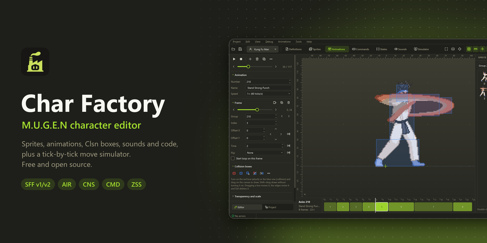
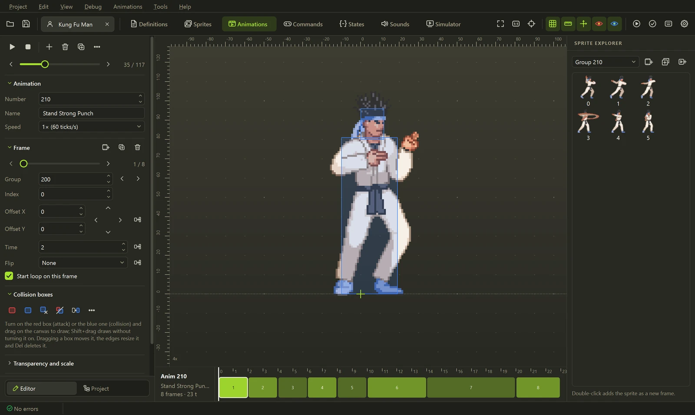
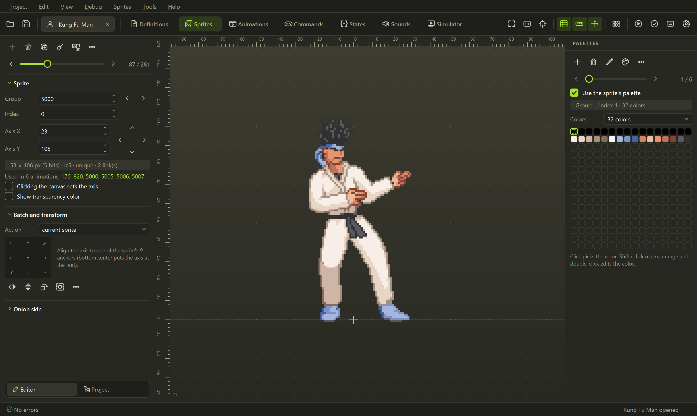
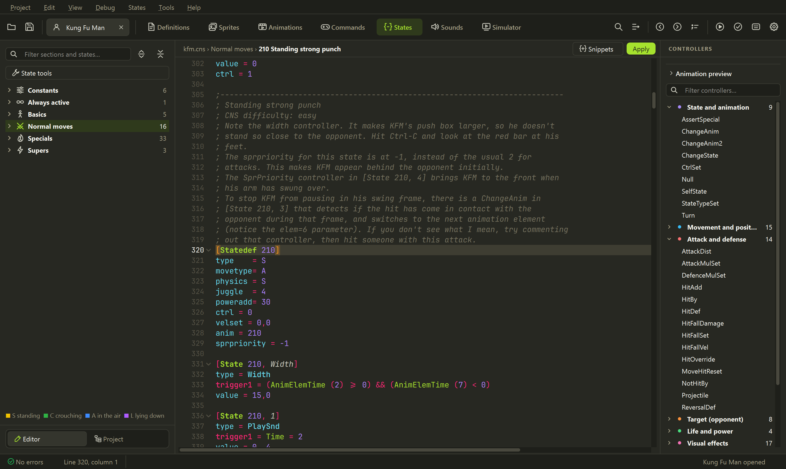
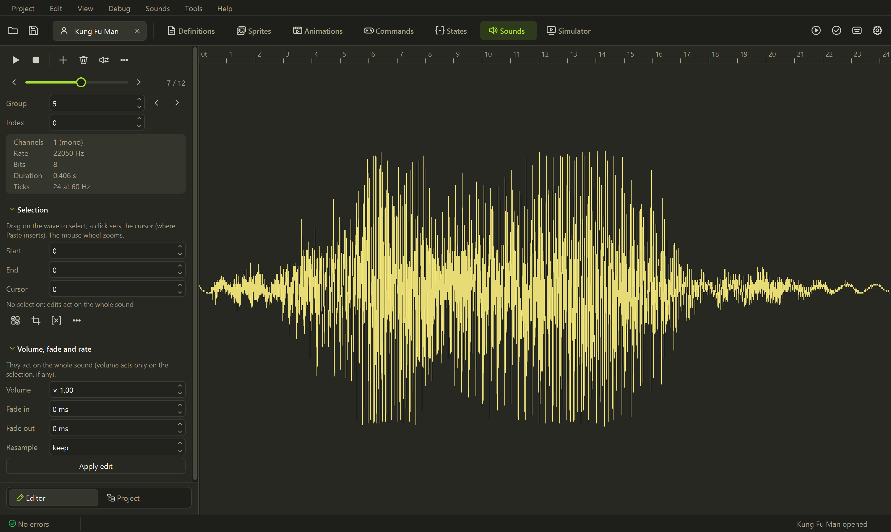
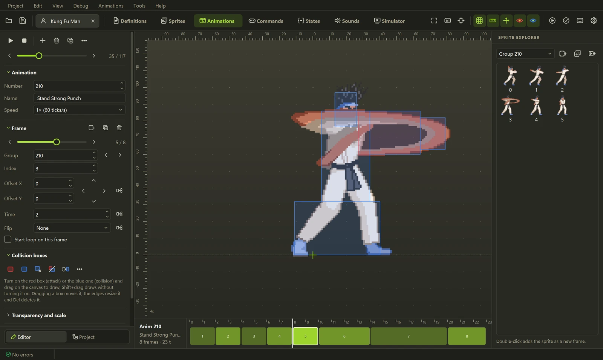

<p align="center">
  
</p>

<p align="center">
  <a href="../../releases/latest"></a>
  <a href="../../actions/workflows/ci.yml"></a>
  <a href="../../releases"></a>
  <a href="#agentes-de-ia-e-mcp"></a>
  <a href="LICENSE"></a>
</p>

<p align="center">
  Editor livre e de código aberto para personagens de <b>M.U.G.E.N</b> e <b>Ikemen GO</b>. Inspirado no <a href="https://virtualltek.com/">Fighter Factory</a>.<br>
  Sprites, animações, caixas de colisão, sons e código numa só janela, um simulador que roda<br>
  seus golpes tick a tick e <b>agentes de IA</b> (Claude, Codex, Gemini) que editam o personagem com você.
</p>

<p align="center">
  <b><a href="../../releases/latest">Baixar para Windows</a></b> ·
  <a href="#agentes-de-ia-e-mcp">IA e MCP</a> ·
  <a href="#o-que-ele-tem-de-diferente">O que ele tem de diferente</a> ·
  <a href="#os-editores">Os editores</a> ·
  <a href="#linha-de-comando">Linha de comando</a> ·
  <a href="#desenvolvimento">Desenvolvimento</a>
  <br>
  <sub><a href="README.md">English</a> · <a href="README.es.md">Español</a> · <a href="README.fr.md">Français</a> · <b>Português (Brasil)</b> · <a href="README.zh-CN.md">简体中文</a></sub>
</p>

## Primeiros passos

1. Baixe o `Char-Factory-...-windows.zip` da **[última versão](../../releases/latest)**.
2. Extraia em qualquer pasta e abra o **`Char Factory.exe`**. Não precisa instalar nada.
3. Abra o `.def` de um personagem, ou arraste um `.def`, `.zip`, `.rar` ou `.7z` para a janela.

Na primeira vez o app pergunta o idioma e o tema. Se o personagem estiver dentro da pasta do MUGEN ou
do Ikemen GO, **Rodar no motor** (<kbd>Ctrl</kbd>+<kbd>R</kbd>) acha esse motor sozinho;
**Depurar → Rodar no MUGEN / Rodar no Ikemen GO** testa o mesmo personagem no outro.

## Agentes de IA e MCP


<p align="center"><sub>Um pedido, um golpe novo: o assistente escolhe as poses, monta as animações e os estados, liga
o comando, corrige o chute que errou e mostra o resultado no simulador. Ferramentas reais, no Kung Fu Man.</sub></p>

Peça um golpe com suas palavras e um agente de IA monta ele no personagem aberto: lê os estados,
**olha as animações** para escolher as poses certas, escreve o código, ajusta as caixas de colisão e
**roda o golpe no simulador** para confirmar que acerta antes de dizer que terminou. Cada mudança
aparece no editor na hora, <kbd>Ctrl</kbd>+<kbd>Z</kbd> desfaz, e nada vai para o disco até você
salvar.

<table>
  <tr>
    <td width="50%" valign="top">
      <b>Assistente embutido</b> · <kbd>Ctrl</kbd>+<kbd>Shift</kbd>+<kbd>A</kbd><br><br>
      Um painel lateral que conversa com o <b>Claude</b>, a <b>OpenAI</b> (GPT) ou o <b>Gemini</b> com a sua chave de API,
      ou com um modelo local pelo Ollama ou LM Studio. Ele sabe o que você está vendo (o statedef
      sob o cursor, a animação e o quadro), então <i>"deixa isso mais rápido"</i> funciona.
    </td>
    <td width="50%" valign="top">
      <b>Seu próprio agente via MCP</b><br><br>
      <b>Claude Code</b>, <b>Codex</b>, <b>Claude Desktop</b>, <b>Gemini CLI</b>, <b>Cursor</b> ou
      <b>VS Code</b> se conectam ao Char Factory e editam o personagem na tela com <b>a sua própria
      assinatura</b>, sem chave de API. Só local (<code>127.0.0.1</code>) e protegido por token.
    </td>
  </tr>
</table>


<details>
<summary><b>O que o agente consegue fazer (35 ferramentas)</b></summary>
<br>

| | Ferramentas |
|---|---|
| **Entender um golpe** | `get_move` (statedef, animações, comando e veredito numa chamada), `list_states`, `list_animations` com busca, `test_command` (a que estado um comando leva) |
| **Ver** | `view_animations` (folha de contato com as poses candidatas), `view_animation`, `view_sprite` |
| **Criar** | `create_move` (statedef, comando e entrada no `[Statedef -1]`), `build_animation` (caixas ajustadas a cada sprite), `set_state`, `add_controller`, `add_command` |
| **Mudar com precisão** | `edit_state` (um parâmetro, comentários mantidos), `edit_animation` (quadros, tempos, caixas), `set_constant` |
| **Conferir** | `simulate_state` (frame data e a trajetória: para onde o personagem vai, de que lado acerta), `validate_character`, `mugen_reference`, `mugen_guide` |

As proteções já vêm prontas: um golpe existente nunca é sobrescrito sem querer, um comando que outro
golpe já usa é recusado com a lista dos livres, caixas do AIR que o parser descartaria são rejeitadas, e
uma resposta cortada pelo limite de saída nunca é aplicada pela metade.

</details>

### Como configurar

O jeito mais rápido: **IA → Conectar um agente (MCP)**, marque **Rodar o servidor MCP enquanto o Char
Factory estiver aberto**, escolha o seu cliente e copie a configuração que aparece (a URL e o seu token
já vêm preenchidos). Deixe o Char Factory aberto com o personagem carregado enquanto o agente trabalha.

<p align="center">
  
</p>

<details open>
<summary><b>Claude Code</b> (usa a sua assinatura do Claude)</summary>
<br>

```powershell
claude mcp add --transport http charfactory http://127.0.0.1:47913/mcp --header "Authorization: Bearer <seu token>"
```

Depois rode `claude` e peça, por exemplo: *"Abra o personagem no Char Factory, olhe os chutes
agachados e faça um novo que acerte baixo"*. O `/mcp` mostra que o `charfactory` está conectado.

Sem a janela, o Claude Code também pode subir o servidor sozinho num personagem:
`claude mcp add charfactory -- "C:\caminho\para\Char Factory.exe" --mcp "C:\caminho\para\char.def"`.

</details>

<details>
<summary><b>Codex</b> (usa a sua assinatura do ChatGPT)</summary>
<br>

Acrescente em `~/.codex/config.toml`:

```toml
[mcp_servers.charfactory]
url = "http://127.0.0.1:47913/mcp"
http_headers = { "Authorization" = "Bearer <seu token>" }
```

Depois rode `codex` e peça a mudança. Ou suba o servidor por stdio:
`codex mcp add charfactory -- "C:\caminho\para\Char Factory.exe" --mcp`.

</details>

<details>
<summary><b>Claude Desktop, Gemini CLI, Cursor, VS Code</b></summary>
<br>

A lista **Conectar um cliente**, na mesma aba, tem o trecho exato para cada um. O Claude Desktop
inicia o `Char Factory.exe --mcp`, que se conecta à janela aberta (acrescente no
`claude_desktop_config.json` em *Settings → Developer → Edit Config* e reinicie o Claude). Qualquer
outro cliente fala Streamable HTTP com `http://127.0.0.1:47913/mcp` usando o cabeçalho
`Authorization: Bearer <seu token>`.

</details>

<details>
<summary><b>Assistente embutido com chave de API</b> (Claude, OpenAI ou Gemini)</summary>
<br>

1. **IA → Configurações de IA…**, aba **Assistente**.
2. Escolha o provedor: **Anthropic (Claude)**, **OpenAI (GPT)**, **Google Gemini**, ou
   **OpenAI-compatible** para OpenRouter, Ollama ou LM Studio (informe a URL base).
3. Cole a chave (**Obter uma chave** abre a página do provedor) e clique em **Testar conexão**, que
   também carrega os modelos na lista. O Claude usa `claude-opus-5-5` por padrão.
4. Abra o painel com <kbd>Ctrl</kbd>+<kbd>Shift</kbd>+<kbd>A</kbd> e peça.

A chave fica no Gerenciador de Credenciais do Windows, nunca no arquivo de configurações. Sem chave
salva, vale a `ANTHROPIC_API_KEY`, a `OPENAI_API_KEY` ou a `GEMINI_API_KEY`. Com o Claude, o assistente
usa cache de prompt e pensamento adaptativo, então sessões longas de edição continuam rápidas e baratas.

</details>

> [!TIP]
> Marque **Perguntar antes de uma IA alterar o personagem** para aprovar cada mudança, e use as linhas
> de passo do painel (clique numa) para ver exatamente o que o agente enviou e recebeu.

## O que ele tem de diferente

### Frame data, e um backup lado a lado


<kbd>F9</kbd> roda um estado tick a tick, com helpers, explods e pausas de acerto, e mede os quadros de
startup, ativos e de recuperação e a vantagem no acerto ou na defesa. Escolha um backup em **Comparar** e as
duas versões rodam lado a lado. O P2 pode ficar em pé, defender, agachar ou estar no ar, e os golpes se
encadeiam em combos.

### Uma timeline que edita o código


Cada quadro, acerto, som e efeito de um golpe numa só faixa. Arraste um som ou um efeito para outro tick
e o trigger dele é reescrito (`Time = N`, `!Time` ou `AnimElem = N`); dê um duplo clique em qualquer evento
para abrir o controller.

### Caixas de colisão com um clique


Clsn2 anatômicos (cabeça, tronco, pernas) a partir da silhueta do sprite, o Clsn1 de ataque no membro
esticado, e caixas interpoladas entre dois quadros-chave.

### Paleta de comandos e ir para a definição


<kbd>F1</kbd> roda qualquer comando ou pula para `anim 200`, `state 1000`, `sprite 9000,0` ou `sound 5,0`.
No código, <kbd>F12</kbd> ou <kbd>Ctrl</kbd>+clique abre a definição sob o cursor.

### E as ferramentas em volta

<table>
  <tr>
    <td width="50%" valign="top">
      <br>
      <b>Transplante de golpe</b><br>
      Copia um golpe inteiro de outro personagem, seguindo <code>ChangeState</code>,
      <code>Helper</code> e <code>p1/p2stateno</code>, com animações, sprites, sons e
      comando, renumerados para nada colidir.
    </td>
    <td width="50%" valign="top">
      <br>
      <b>Assistente de golpes</b><br>
      Monte um golpe visualmente (HitDef, física, sons, cancels, comando) e veja o CNS sendo
      escrito enquanto edita.
    </td>
  </tr>
  <tr>
    <td width="50%" valign="top">
      <br>
      <b>Recorte de sprite sheet</b><br>
      Acha o fundo e cada quadro, põe o eixo nos pés e monta uma paleta só, pronto
      para importar.
    </td>
    <td width="50%" valign="top">
      <br>
      <b>Um editor de paletas, 12 paletas por faixas de cor</b><br>
      Todas as paletas numa faixa, ferramentas de cor, a paleta nova vista antes de salvar, e uma aba que
      trava o que não pode mudar (pele, contorno) e gera as paletas 2 a 12. Com Ctrl+Z.
    </td>
  </tr>
  <tr>
    <td width="50%" valign="top">
      <br>
      <b>Editor de pixels sobre os índices da paleta</b><br>
      <kbd>Ctrl</kbd>+<kbd>E</kbd>: seleção, varinha mágica, contorno, onion skin, e
      <kbd>PgUp</kbd>/<kbd>PgDn</kbd> pelos sprites sem fechar.
    </td>
    <td width="50%" valign="top">
      <br>
      <b>Recursos não usados</b><br>
      Sprites, animações e sons que nada referencia, prontos para apagar antes de lançar.
    </td>
  </tr>
</table>

## Os editores



Animações num canvas com réguas, grade e eixo, caixas Clsn desenhadas com o mouse, cada quadro numa
timeline do tamanho da sua duração, escala, ângulo e interpolação do MUGEN 1.1, e exportação para GIF.

<table>
  <tr>
    <td width="50%" valign="top">
      <br>
      <b>Sprites e paletas</b><br>
      Importe, exporte e alinhe sprites, edite paletas e arquivos ACT, ou abra um sprite num
      editor externo como o Aseprite.
    </td>
    <td width="50%" valign="top">
      <br>
      <b>Código</b><br>
      CNS, CMD, AIR e DEF com realce, documentação ao passar o mouse, snippets e validação ao vivo; os
      comentários são mantidos ao salvar.
    </td>
  </tr>
  <tr>
    <td width="50%" valign="top">
      <br>
      <b>Sons</b><br>
      Toque, corte, aplique fade e reamostre numa régua medida em ticks do jogo; importa WAV, OGG, MP3 e FLAC.
    </td>
    <td width="50%" valign="top">
      <br>
      <b>Temas</b><br>
      Oito temas embutidos, um editor de temas e importação de colorsets <code>.xml</code>.
    </td>
  </tr>
</table>

<details>
<summary><b>Todo o resto</b></summary>
<br>

- **Ferramentas:** testador de comandos, criador de arremessos, editor de PalFX, visualizador de offsets,
  organizador do `[Statedef -1]`, lista de uso de variáveis, calculadora e exportação da lista de golpes em HTML.
- **Stages:** camadas, propriedades e uma prévia com câmera e parallax.
- **Projetos:** vários personagens em abas, desfazer e refazer em tudo, backup automático, comparar com um
  backup, localizar e substituir em todos os arquivos, abrir e empacotar `.zip`.
- **Idiomas:** inglês, espanhol, francês, português (Brasil) e chinês simplificado, com o tamanho do
  texto da interface e do código ajustável.

</details>

### Formatos suportados

| Formato | Lê | Grava |
|---|:---:|:---:|
| SFF v1.01 (PCX) e v2.00/2.01 (RLE8, RLE5, LZ5, PNG) | ✓ | ✓ <sub>(menos RLE5)</sub> |
| AIR, CMD, CNS, ST, DEF <sub>(comentários mantidos)</sub> | ✓ | ✓ |
| ZSS (Ikemen GO) | ✓ | ✓ |
| SND, ACT | ✓ | ✓ |
| ZIP, RAR, 7z (personagem compactado) | ✓ | ZIP |

## Linha de comando


Tudo o que o editor faz com os arquivos também funciona em scripts ou CI, sem janela:

```powershell
charfactory render kfm.def 200 out.gif    # renderiza uma animação
charfactory sim kfm.def 210 --gif         # simula um estado tick a tick
charfactory convert-sff in.sff out.sff --version 1
charfactory run kfm.def --engine ikemen    # uma luta rápida no Ikemen GO (ou mugen, ou auto)
charfactory mcp kfm.def                   # servidor MCP por stdio, para agentes (sem janela)
charfactory --help                        # todos os comandos
```

## Desenvolvimento

Precisa do Python 3.11 ou mais novo.

```powershell
git clone https://github.com/eduardovbe/CharFactory.git
cd CharFactory
python -m venv .venv
.venv\Scripts\pip install -e ".[gui,test]"
.venv\Scripts\charfactory-gui
```

Testes, traduções, a geração do executável e destas capturas estão no
[CONTRIBUTING.md](CONTRIBUTING.md) (em inglês). Relatos de bugs, traduções e pull requests são bem-vindos; siga o
[Código de Conduta](CODE_OF_CONDUCT.md) e informe problemas de segurança como descrito no
[SECURITY.md](SECURITY.md).

## Licença

[MIT](LICENSE). A fonte JetBrains Mono incluída está sob a SIL Open Font License 1.1.

<sub>Inspirado no Fighter Factory. Projeto independente, sem vínculo com a Elecbyte, os autores do Fighter
Factory, a Anthropic, a OpenAI ou o Google. M.U.G.E.N é marca da Elecbyte. As capturas mostram o Kung Fu
Man, o personagem de exemplo que vem com o M.U.G.E.N.</sub>
