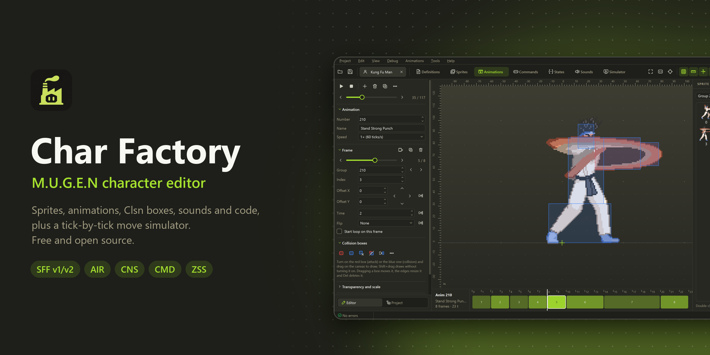
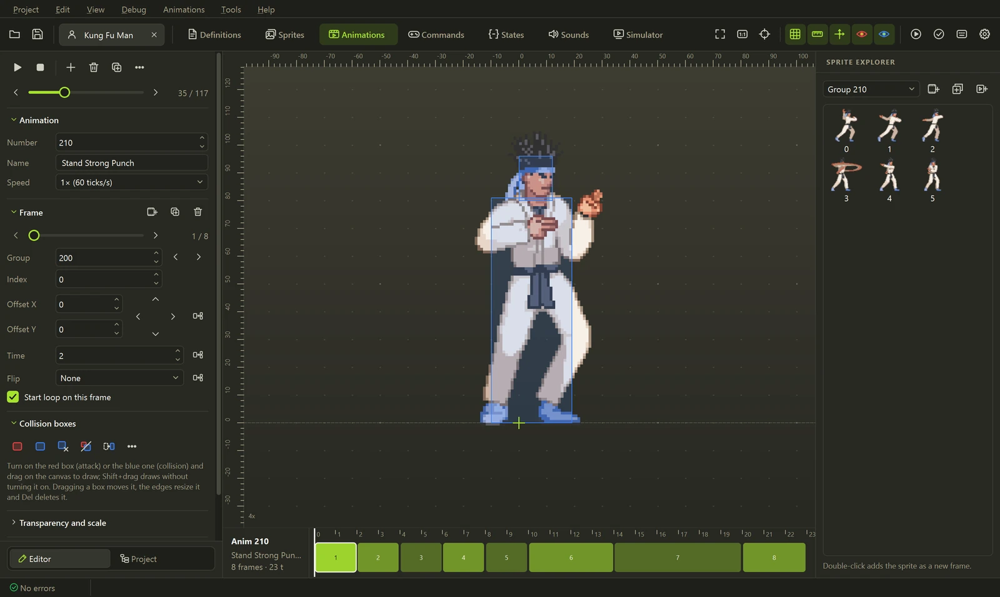
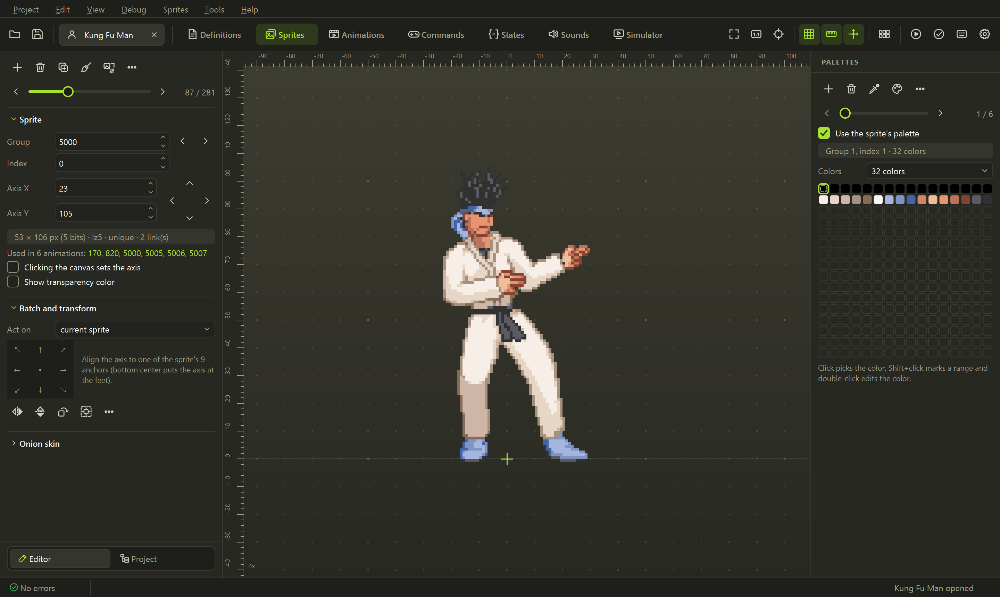
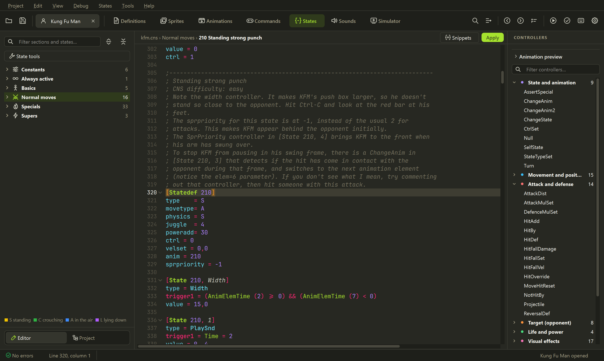
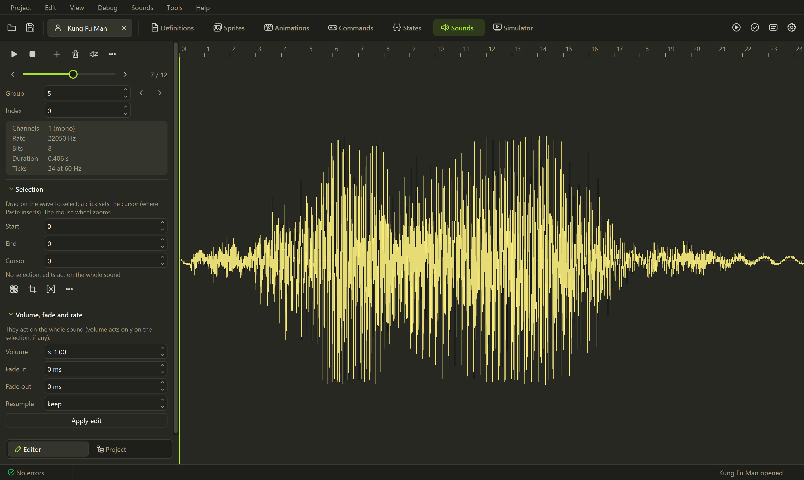
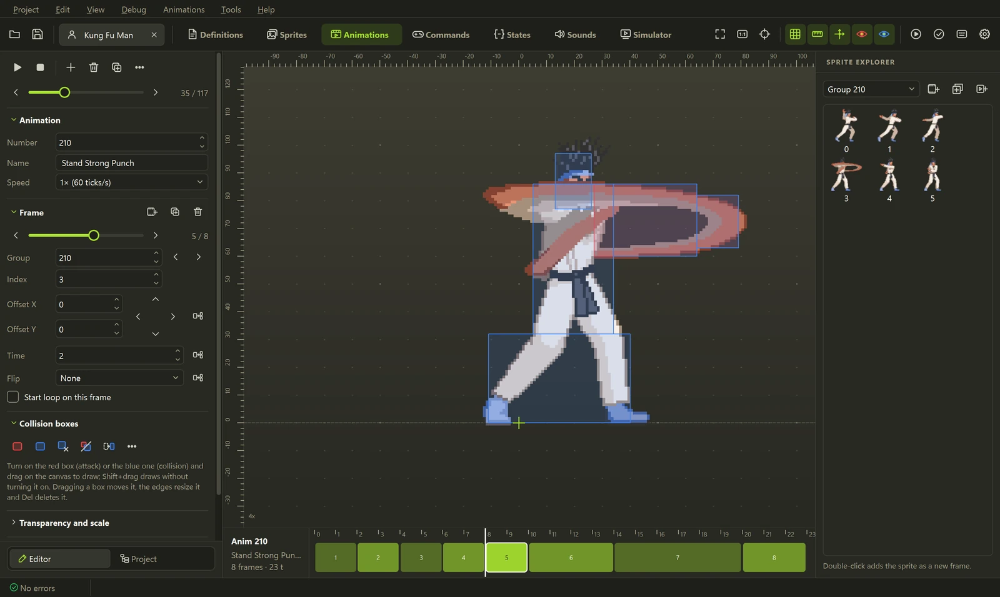

<p align="center">
  
</p>

<p align="center">
  <a href="../../releases/latest"></a>
  <a href="../../actions/workflows/ci.yml"></a>
  <a href="../../releases"></a>
  <a href="#ai-代理与-mcp"></a>
  <a href="LICENSE"></a>
</p>

<p align="center">
  免费、开源的 <b>M.U.G.E.N</b> 与 <b>Ikemen GO</b> 角色编辑器，灵感来自 <a href="https://virtualltek.com/">Fighter Factory</a>。<br>
  精灵、动画、碰撞框、声音和代码都在同一个窗口里；模拟器逐 tick 播放你的招式；<br>
  <b>AI 代理</b>（Claude、Codex、Gemini）和你一起编辑角色。
</p>

<p align="center">
  <b><a href="../../releases/latest">下载 Windows 版</a></b> ·
  <a href="#ai-代理与-mcp">AI 与 MCP</a> ·
  <a href="#与众不同之处">与众不同之处</a> ·
  <a href="#编辑器">编辑器</a> ·
  <a href="#命令行">命令行</a> ·
  <a href="#开发">开发</a>
  <br>
  <a href="README.md"> English</a> &nbsp;·&nbsp; <a href="README.es.md"> Español</a> &nbsp;·&nbsp; <a href="README.fr.md"> Français</a> &nbsp;·&nbsp; <a href="README.pt-BR.md"> Português (Brasil)</a> &nbsp;·&nbsp;  <b>简体中文</b>
</p>

## 快速开始

1. 从 **[最新版本](../../releases/latest)** 下载 `Char-Factory-...-windows.zip`。
2. 解压到任意位置，打开 **`Char Factory.exe`**。无需安装。
3. 打开角色的 `.def`，或把 `.def`、`.zip`、`.rar`、`.7z` 拖到窗口上。

首次启动时会让你选择语言和主题。如果角色位于 MUGEN 或 Ikemen GO 文件夹内，**在引擎中运行**
（<kbd>Ctrl</kbd>+<kbd>R</kbd>）会自动找到对应的引擎；**调试 → 在 MUGEN 中运行 / 在 Ikemen GO 中运行**
可以在另一个引擎里测试同一个角色。

## AI 代理与 MCP


<p align="center"><sub>一个请求，一个新招式：助手挑选姿势，建立动画和状态，接好指令，修正落空的踢击，
并在模拟器中展示结果。以上是在 Kung Fu Man 上使用的真实工具。</sub></p>

用平常的话描述一个招式，AI 代理就会在打开的角色里把它做出来：读取状态，**查看动画**挑出合适的姿势，
编写代码，调整碰撞框，并在告诉你完成之前**在模拟器中运行招式**，确认能够命中。每次修改都会立刻出现在
编辑器里，<kbd>Ctrl</kbd>+<kbd>Z</kbd> 可以撤销，保存之前不会写入磁盘。

<table>
  <tr>
    <td width="50%" valign="top">
      <b>内置助手</b> · <kbd>Ctrl</kbd>+<kbd>Shift</kbd>+<kbd>A</kbd><br><br>
      侧边面板，使用你的 API 密钥与 <b>Claude</b>、<b>OpenAI</b>（GPT）或 <b>Gemini</b> 对话，
      也可以通过 Ollama 或 LM Studio 使用本地模型。它知道你正在看什么（光标所在的 statedef、
      当前动画和帧），所以直接说<i>“让它快一点”</i>就行。
    </td>
    <td width="50%" valign="top">
      <b>通过 MCP 使用你自己的代理</b><br><br>
      <b>Claude Code</b>、<b>Codex</b>、<b>Claude Desktop</b>、<b>Gemini CLI</b>、<b>Cursor</b> 或
      <b>VS Code</b> 连接到 Char Factory，用<b>你自己的订阅</b>编辑屏幕上的角色，无需 API 密钥。
      仅限本机（<code>127.0.0.1</code>），并由令牌保护。
    </td>
  </tr>
</table>


<details>
<summary><b>代理能做什么（35 个工具）</b></summary>
<br>

| | 工具 |
|---|---|
| **理解招式** | `get_move`（一次调用获取 statedef、动画、输入和结论）、`list_states`、带搜索的 `list_animations`、`test_command`（某个输入会进入哪个状态） |
| **查看** | `view_animations`（候选姿势的缩略图总览）、`view_animation`、`view_sprite` |
| **创建** | `create_move`（statedef、指令和 `[Statedef -1]` 条目）、`build_animation`（按每个精灵拟合碰撞框）、`set_state`、`add_controller`、`add_command` |
| **精确修改** | `edit_state`（只改一个参数，保留注释）、`edit_animation`（帧、时长、碰撞框）、`set_constant` |
| **检查** | `simulate_state`（帧数据和移动轨迹：角色去往哪里、从哪一侧命中）、`validate_character`、`mugen_reference`、`mugen_guide` |

内置多重保护：不会意外覆盖已有招式；其他招式已占用的输入会被拒绝，并列出可用的输入；解析器会丢弃的
AIR 碰撞框会被拒绝；因输出长度限制而被截断的回复绝不会只应用一半。

</details>

### 设置

最快的方法：**AI → 连接代理（MCP）**，勾选 **Char Factory 打开期间运行 MCP 服务器**，选择你的客户端，
复制显示的配置（URL 和你的令牌已经填好）。代理工作期间，请保持 Char Factory 打开并载入角色。

<p align="center">
  
</p>

<details open>
<summary><b>Claude Code</b>（使用你的 Claude 订阅）</summary>
<br>

```powershell
claude mcp add --transport http charfactory http://127.0.0.1:47913/mcp --header "Authorization: Bearer <你的令牌>"
```

然后启动 `claude` 并提出要求，例如：*“在 Char Factory 中打开角色，看看下蹲踢，再做一个打下段的新招”*。
`/mcp` 会显示 `charfactory` 已连接。

不打开窗口时，Claude Code 也可以自己针对某个角色启动服务器：
`claude mcp add charfactory -- "C:\路径\Char Factory.exe" --mcp "C:\路径\char.def"`。

</details>

<details>
<summary><b>Codex</b>（使用你的 ChatGPT 订阅）</summary>
<br>

添加到 `~/.codex/config.toml`：

```toml
[mcp_servers.charfactory]
url = "http://127.0.0.1:47913/mcp"
http_headers = { "Authorization" = "Bearer <你的令牌>" }
```

然后运行 `codex` 并提出修改。也可以改用 stdio 启动服务器：
`codex mcp add charfactory -- "C:\路径\Char Factory.exe" --mcp`。

</details>

<details>
<summary><b>Claude Desktop、Gemini CLI、Cursor、VS Code</b></summary>
<br>

同一标签页中的 **连接客户端** 列表给出了每个客户端的准确配置片段。Claude Desktop 会启动
`Char Factory.exe --mcp`，并连接到已打开的窗口（在 *Settings → Developer → Edit Config* 中添加到
`claude_desktop_config.json`，然后重启 Claude）。其他客户端通过 Streamable HTTP 连接
`http://127.0.0.1:47913/mcp`，并带上请求头 `Authorization: Bearer <你的令牌>`。

</details>

<details>
<summary><b>使用 API 密钥的内置助手</b>（Claude、OpenAI 或 Gemini）</summary>
<br>

1. **AI → AI 设置…**，**助手** 标签页。
2. 选择服务商：**Anthropic (Claude)**、**OpenAI (GPT)**、**Google Gemini**，或选择
   **OpenAI-compatible** 以使用 OpenRouter、Ollama 或 LM Studio（填写其基础 URL）。
3. 粘贴密钥（**获取密钥** 会打开服务商的页面），然后点击 **测试连接**，同时会把模型载入列表。
   Claude 默认使用 `claude-opus-5-5`。
4. 用 <kbd>Ctrl</kbd>+<kbd>Shift</kbd>+<kbd>A</kbd> 打开面板，开始提问。

密钥保存在 Windows 凭据管理器中，从不写入设置文件。没有保存密钥时，会使用 `ANTHROPIC_API_KEY`、
`OPENAI_API_KEY` 或 `GEMINI_API_KEY`。使用 Claude 时，助手会缓存提示词并进行自适应思考，长时间的编辑
也能保持快速且便宜。

</details>

> [!TIP]
> 勾选 **AI 修改角色前先询问** 可以逐项批准修改；点击面板中的步骤行，可以看到代理具体发送和收到了什么。

## 与众不同之处

### 帧数据，并与备份并排对比


<kbd>F9</kbd> 逐 tick 运行一个状态，包括 helper、explod 和命中停顿，并测量发生、持续和收招帧数，
以及命中或被防御时的帧优势。在 **比较** 中选择一个备份，两个版本就会并排播放。P2 可以站立、防御、
下蹲或处于空中，招式可以连成连段。

### 能编辑代码的时间轴


一个招式的每一帧、每次命中、每个声音和特效都在同一条轨道上。把声音或特效拖到另一个 tick，它的触发器
就会被改写（`Time = N`、`!Time` 或 `AnimElem = N`）；双击任何事件即可打开对应的控制器。

### 一键生成碰撞框


根据精灵轮廓生成按身体部位划分的 Clsn2（头、躯干、腿），在伸出的肢体上生成攻击用 Clsn1，
还能在两个关键帧之间插值生成碰撞框。

### 命令面板与转到定义


<kbd>F1</kbd> 可以运行任何命令，或跳转到 `anim 200`、`state 1000`、`sprite 9000,0`、`sound 5,0`。
在代码中，<kbd>F12</kbd> 或 <kbd>Ctrl</kbd>+单击会打开光标处的定义。

### 以及周边工具

<table>
  <tr>
    <td width="50%" valign="top">
      <br>
      <b>招式移植</b><br>
      从另一个角色复制完整的招式，沿着 <code>ChangeState</code>、<code>Helper</code> 和
      <code>p1/p2stateno</code> 追踪，连同动画、精灵、声音和指令一起复制，并重新编号以避免冲突。
    </td>
    <td width="50%" valign="top">
      <br>
      <b>招式向导</b><br>
      以可视化方式设计招式（HitDef、物理、声音、取消、指令），编辑时实时看到 CNS 的生成。
    </td>
  </tr>
  <tr>
    <td width="50%" valign="top">
      <br>
      <b>精灵图集切分</b><br>
      识别背景和每一帧，把坐标轴放在脚下，并生成统一的调色板，可直接导入。
    </td>
    <td width="50%" valign="top">
      <br>
      <b>一个调色板编辑器，按颜色区段生成 12 套调色板</b><br>
      所有调色板排成一条，配有颜色工具，新调色板可在保存前预览；还有一个标签页可以锁定不能改变的部分
      （皮肤、轮廓），并生成第 2 到第 12 套调色板。支持 Ctrl+Z。
    </td>
  </tr>
  <tr>
    <td width="50%" valign="top">
      <br>
      <b>基于调色板索引的像素编辑器</b><br>
      <kbd>Ctrl</kbd>+<kbd>E</kbd>：选区、魔棒、描边、洋葱皮，并可用
      <kbd>PgUp</kbd>/<kbd>PgDn</kbd> 在精灵之间切换，无需关闭。
    </td>
    <td width="50%" valign="top">
      <br>
      <b>未使用的资源</b><br>
      列出没有被任何地方引用的精灵、动画和声音，发布前可以直接删除。
    </td>
  </tr>
</table>

## 编辑器



动画显示在带标尺、网格和坐标轴的画布上，用鼠标绘制 Clsn 碰撞框，每一帧在时间轴上的长度与其时长一致，
支持 MUGEN 1.1 的缩放、角度和插值，并可导出 GIF。

<table>
  <tr>
    <td width="50%" valign="top">
      <br>
      <b>精灵与调色板</b><br>
      导入、导出和对齐精灵，编辑调色板和 ACT 文件，或在 Aseprite 等外部编辑器中打开精灵。
    </td>
    <td width="50%" valign="top">
      <br>
      <b>代码</b><br>
      CNS、CMD、AIR 和 DEF，支持语法高亮、悬停文档、代码片段和实时校验；保存时保留注释。
    </td>
  </tr>
  <tr>
    <td width="50%" valign="top">
      <br>
      <b>声音</b><br>
      在以游戏 tick 为刻度的标尺上播放、剪切、淡入淡出和重采样；可导入 WAV、OGG、MP3 和 FLAC。
    </td>
    <td width="50%" valign="top">
      <br>
      <b>主题</b><br>
      八个内置主题、一个主题编辑器，并可导入 <code>.xml</code> 配色方案。
    </td>
  </tr>
</table>

<details>
<summary><b>其他功能</b></summary>
<br>

- **工具：** 指令测试器、投技生成器、PalFX 编辑器、偏移查看器、`[Statedef -1]` 整理工具、
  变量使用列表、计算器，以及 HTML 招式表导出。
- **场景：** 图层、属性，以及带镜头和视差的预览。
- **项目：** 多个角色分标签页打开，处处可撤销和重做，自动备份，与备份比较，在所有文件中查找和替换，
  打开和打包 `.zip`。
- **语言：** 英语、西班牙语、法语、葡萄牙语（巴西）和简体中文，界面和代码的文字大小均可调整。

</details>

### 支持的格式

| 格式 | 读取 | 写入 |
|---|:---:|:---:|
| SFF v1.01（PCX）和 v2.00/2.01（RLE8、RLE5、LZ5、PNG） | ✓ | ✓ <sub>（RLE5 除外）</sub> |
| AIR、CMD、CNS、ST、DEF <sub>（保留注释）</sub> | ✓ | ✓ |
| ZSS（Ikemen GO） | ✓ | ✓ |
| SND、ACT | ✓ | ✓ |
| ZIP、RAR、7z（压缩包中的角色） | ✓ | ZIP |

## 命令行


编辑器对文件做的一切，也都可以在脚本或 CI 中完成，不需要窗口：

```powershell
charfactory render kfm.def 200 out.gif    # 渲染动画
charfactory sim kfm.def 210 --gif         # 逐 tick 模拟一个状态
charfactory convert-sff in.sff out.sff --version 1
charfactory run kfm.def --engine ikemen    # 在 Ikemen GO 中快速对战（或 mugen、auto）
charfactory mcp kfm.def                   # 通过 stdio 运行 MCP 服务器，供代理使用（无需窗口）
charfactory --help                        # 所有命令
```

## 开发

需要 Python 3.11 或更高版本。

```powershell
git clone https://github.com/eduardovbe/CharFactory.git
cd CharFactory
python -m venv .venv
.venv\Scripts\pip install -e ".[gui,test]"
.venv\Scripts\charfactory-gui
```

测试、翻译、构建可执行文件以及重新生成这些截图的方法见 [CONTRIBUTING.md](CONTRIBUTING.md)（英文）。
欢迎提交错误报告、翻译和拉取请求；请遵守[行为准则](CODE_OF_CONDUCT.md)，并按照
[SECURITY.md](SECURITY.md) 中的说明报告安全问题。

## 许可证

[MIT](LICENSE)。内置的 JetBrains Mono 字体采用 SIL Open Font License 1.1。

<sub>灵感来自 Fighter Factory。本项目为独立项目，与 Elecbyte、Fighter Factory 的作者、Anthropic、OpenAI
或 Google 均无关联。M.U.G.E.N 是 Elecbyte 的商标。截图中的角色是 M.U.G.E.N 自带的示例角色 Kung Fu Man。</sub>
